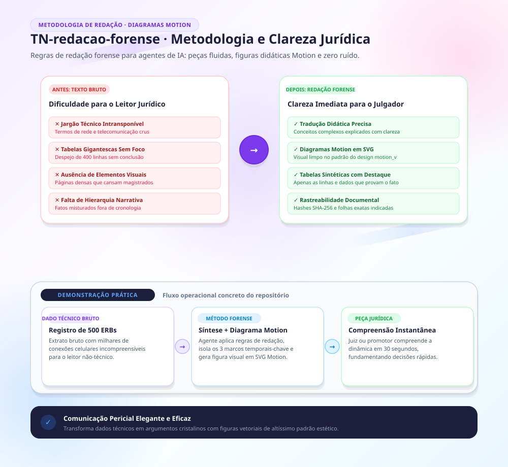

Feito por cópia de repo privado redacao-forense na versão v1.0 de TN em 11/2026.

---

# Redação Forense Universal para Agentes de Código e IA

> **Metodologia analítica, estilo probatório e arquitetura documental de Informações de Polícia Judiciária (IPJs) e relatórios de inteligência policial, extraídos de um acervo de 90 peças efetivamente assinadas e verificadas citação a citação contra o texto-fonte.**

Este repositório fornece uma personalização **100% agnóstica e universal**, pronta para ser integrada a **qualquer agente de IA ou assistente de código** (Antigravity, Claude Code, Cursor, Windsurf, Codex, OpenCode, GitHub Copilot, Ollama e LLMs via Web/API).

**Diferencial deste acervo:** nenhuma regra ou fórmula aqui é estilo genérico de redação policial — cada uma foi extraída de peça real, com autoria confirmada, e passou por um painel de verificação adversarial (citação conferida contra o arquivo-fonte, contagem e atribuição checadas) antes de entrar no repositório. Achado de peça de autoria mista (co-assinada) nunca entra como regra de voz confirmada, só com nota de proveniência explícita.

---

## 🎯 Propósito: a ponte epistêmica para o leigo jurídico

O público-alvo de um relatório de inteligência ou IPJ é composto por **juízes, promotores, delegados e defensores públicos** — operadores do Direito sem formação em computação, contabilidade pericial, telecomunicações ou blockchain. Esta personalização instrui o agente a:

1. **Traduzir o termo técnico numa frase, logo após citá-lo** — nunca em rodapé ou glossário à parte. Isso não é simplificar o conteúdo, é permitir clareza e precisão técnica ao mesmo tempo.
2. **Simular o raciocínio do leitor leigo/vítima** — refazer, na prosa, a pesquisa que uma pessoa comum faria e mostrar por que ela falha, em vez de só afirmar a limitação.
3. **Declarar a autolimitação antecipada**, sempre seguida de "Não obstante" e do que se sustenta apesar dela — reconhecer a lacuna sem desistir da conclusão.
4. **Aplicar a escada de certeza**: cada afirmação no grau que a prova sustenta (hipótese → indício → reforço → demonstração); "em tese" obrigatório para toda imputação de crime, papel ou intenção — nunca para o dado técnico em si.
5. **Erradicar vícios de LLM em documentos oficiais**: proibição absoluta de emojis, ASCII art de organograma e menção a scripts/prompts de geração no corpo da peça final.
6. **Analisar patrimônio no eixo DECLARADO × OBSERVADO/CONSTATADO** — o que o investigado declarou ao fisco contra o que a investigação observou por telemática, vigilância e fonte aberta. (Não usar "Fórmula do Crédito Descoberto" como termo fixo — não é o vocabulário medido no acervo.)
7. **Estruturar por gênero de peça, não por um único esqueleto**: peça analítica longa ≠ peça que pede medida judicial (organizada por requisito legal, com o pedido resumido no início) ≠ gêneros curtos (informe, status, cadeia de custódia como peça inteira — sem saudação obrigatória).

---

## 🧩 Compatibilidade multi-agente (como cada ferramenta lê)

| Agente / Ambiente | Arquivo de entrada principal | Como é carregado |
|---|---|---|
| **Google Antigravity** | `skills/redacao-forense/SKILL.md` ou `AGENTS.md` | Descoberta automática via `.agents/skills` ou `~/.gemini/config/skills/` |
| **Claude Code (CLI)** | `CLAUDE.md` ou `skills/redacao-forense/` | Lido automaticamente ao abrir o diretório do projeto ou via `~/.claude/skills/` |
| **Claude Desktop** | `CLAUDE.md` / Custom Project Instructions | Carregado no prompt de sistema ou configurações do projeto |
| **Cursor IDE** | `.cursor/rules/redacao-forense.mdc` e `.cursorrules` | Aplicado automaticamente pelo motor de regras do Cursor |
| **Windsurf / Cascade** | `.windsurfrules` | Lido nativamente pelo Cascade no diretório raiz |
| **OpenCode** | `AGENTS.md` | Carregado como regra universal do agente local |
| **Codex** | `AGENTS.md` | Carregado automaticamente via hierarquia de regras globais |
| **GitHub Copilot** | `.github/copilot-instructions.md` | Padrão oficial de instruções do Copilot |
| **Ollama / Web Chats (ChatGPT, Claude, LibreChat)** | `SYSTEM_PROMPT.md` | Copiar e colar no System Prompt ou Modelfile (arquivo autocontido, não referencia os demais) |

`AGENTS.md` é a versão de referência mais completa entre os arquivos curtos — os demais adaptadores remetem a ele para o detalhe. O detalhe máximo, com exemplos, citações e a metodologia patrimonial por extenso, está em `skills/redacao-forense/`.

---

## 📂 Estrutura do repositório

```text
redacao-forense/
├── README.md                              # Documentação central e guia de integração
├── AGENTS.md                              # Padrão universal, mais completo (Antigravity, OpenCode, Codex)
├── CLAUDE.md                              # Padrão para Claude Code CLI e Desktop
├── SYSTEM_PROMPT.md                       # Prompt autocontido para Modelfiles, Custom GPTs e Web
├── .cursorrules                           # Formato clássico para o Cursor IDE
├── .windsurfrules                         # Formato nativo para o Windsurf IDE
├── .cursor/
│   └── rules/
│       └── redacao-forense.mdc            # Regra moderna do Cursor com frontmatter e globs
├── .github/
│   └── copilot-instructions.md            # Instruções para GitHub Copilot
├── skills/
│   └── redacao-forense/
│       ├── SKILL.md                       # Fonte da verdade — regras completas com exemplo e citação
│       └── references/
│           ├── formulario.md              # Frases colhidas do acervo, por seção da peça
│           ├── metodologia-patrimonial.md # Detalhe do eixo DECLARADO × OBSERVADO/CONSTATADO
│           ├── erros-recorrentes.md       # Erros gramaticais sistemáticos e regra de prevenção
│           └── padrao-grafico.md          # Padrão das figuras: proveniência, cinza/daltonismo, sem script no rodapé
├── templates/
│   ├── modelo-ipj-instituicao-completo.md       # Esqueleto da peça analítica longa
│   ├── quadro-declarado-observado.md      # Tabelas de análise patrimonial no eixo verificado
│   └── pedidos-cautelares.md              # Esqueleto da peça que pede medida judicial
└── scripts/
    ├── instalar.ps1                       # Instalador PowerShell para Windows
    ├── instalar.py                        # Instalador Python multiplataforma (Linux/Mac/Win)
    └── grafico/                           # estilo_forense.py (tokens, moldura, auditoria), svg_para_png.py, exemplo e teste
```

---

## 🚀 Instalação e sincronização rápida

Para instalar as diretrizes globalmente nos seus agentes locais (Antigravity, Claude Code, OpenCode, Codex) e/ou num workspace de projeto (Cursor, Windsurf, CLAUDE.md/AGENTS.md locais):

### Windows (PowerShell)
```powershell
powershell -ExecutionPolicy Bypass -File scripts\instalar.ps1
# ou, para um workspace específico:
powershell -ExecutionPolicy Bypass -File scripts\instalar.ps1 -TargetWorkspace "C:\caminho\do\projeto"
```

### Linux / macOS / Windows (Python 3)
```bash
python scripts/instalar.py                    # instalação global
python scripts/instalar.py --workspace .       # instalação no workspace atual
python scripts/instalar.py --check .           # varre em busca de emoji/ASCII art residual
```

O instalador copia `SKILL.md`/`AGENTS.md`/`CLAUDE.md`/`.cursorrules`/`.windsurfrules` para os destinos de cada agente detectado na máquina. A skill completa (`SKILL.md` + `references/`) vai para Antigravity, Claude Code e Codex (`~/.agents/skills/`); no Codex o instalador **não** toca o `~/.codex/AGENTS.md`, que é do usuário. `templates/` e `scripts/grafico/` ficam só no repositório, para consulta e uso manual.

---

## 🔒 Segurança e rigor probatório

- **Sem dados de casos reais.** Todo o repositório usa identificadores fictícios e placeholders padronizados (`[NOME]`, `[CPF]`, `[UNIDADE] [XXX]/[AAAA]`) — nunca nome, CPF, alcunha ou endereço de investigado real.
- **Nenhuma regra sem lastro de autoria confirmada.** Toda citação em `skills/redacao-forense/` foi conferida contra o texto-fonte por um painel de verificação adversarial; achado de peça de autoria mista carrega nota de proveniência explícita, nunca é apresentado como voz confirmada.
- **Cadeia de custódia como princípio, não como frase solta.** As orientações sobre hash, timestamp e transcrição literal (ver `SKILL.md`, seção "Cadeia de custódia dentro do corpo do texto") valem tanto para a peça final quanto para qualquer arquivo de evidência citado nela.
